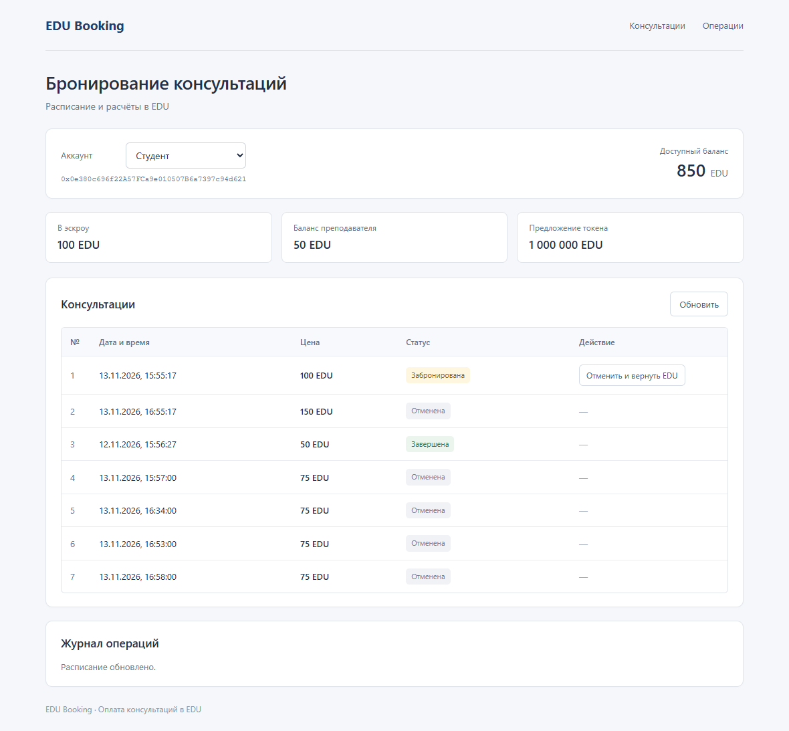

# EDU Booking

Сервис бронирования консультаций с оплатой ERC-20 токеном EDU и хранением оплаты в смарт-контракте.

Курсовой проект по дисциплине «Блокчейн-технологии», НИТУ МИСИС.
Автор: Зейналов Умуд Рамин оглы, МПИ-25-1-2. Преподаватель: Хаммуд О.

Репозиторий: https://github.com/dumuzeyn/edu-booking-blockchain

## Функции

- Преподаватель создаёт консультацию с датой и ценой в EDU.
- Студент разрешает списание точной суммы через `approve`, затем вызывает `book`.
- Контракт получает EDU через `transferFrom` и удерживает их в эскроу.
- До начала студент может отменить бронь и вернуть всю сумму.
- Преподаватель может отменить открытую или оплаченную консультацию; средства возвращаются студенту.
- После начала студент подтверждает проведение, и EDU переводятся преподавателю.
- Через 24 часа после назначенного начала любой участник может вызвать возврат студенту, если подтверждения не было.
- Повторная оплата, повторный возврат и изменение закрытого слота запрещены.

## Полезность EDU и экономика

EDU — взаимозаменяемый внутренний учебный кредит, а не инвестиционный актив. С ним можно оплачивать консультации и повторно использовать полученные кредиты. Токен имеет 18 десятичных знаков. При развёртывании создаётся ровно 1 000 000 EDU для казначейства; дополнительной функции mint нет. `burn` и `burnFrom` позволяют добровольно уничтожать собственные или разрешённые к списанию токены. Оплата консультации ничего не сжигает.

Цена слота задаётся преподавателем в EDU. Продажа токена за рубли/ETH, привязка к курсу, доходность, листинг и обмен на деньги в прототипе не реализованы. Распределение кредитов казначейством — организационная функция; миграция выделяет двум тестовым студентам по 1000 EDU. ETH в Ganache нужен только для газа, стоимость услуги оплачивается EDU.

Для расчётов выбран ERC-20. ERC-721 подходит для уникальных сертификатов, но не для взаимозаменяемых кредитов. ERC-777 добавляет операторов и hooks и требует более сложного анализа внешних вызовов. Сравнение стандартов находится в `docs/STANDARDS.md`.

## Быстрый запуск

Понадобятся Node.js 22 или 24 и npm. Версии зависимостей закреплены в package-lock.json. В среде подготовки проверена работа на Node.js 24 с JS fallback для µWS. Для GitHub Actions задан Node.js 22.

```sh
npm ci
npm run compile
npm test
```

В первом терминале запустите локальную сеть:

```sh
npm run chain
```

Во втором терминале:

```sh
npm run migrate
npm start
```

Откройте http://127.0.0.1:8080. Выберите «Студент», нажмите «Забронировать» на открытой консультации. Интерфейс сначала отправит `approve`, затем `book`. Хеши обеих транзакций появятся в разделе «Операции». Выберите преподавателя для создания/отмены слота, студента — для возврата.

Интерфейс использует светлый фон, компактный блок аккаунта и таблицу консультаций. Статусы выделены цветными метками; основные действия — синими кнопками. Навигация ведёт к расписанию и журналу операций. На узком экране таблица прокручивается внутри своего блока.

Это локальный демонстрационный режим с разблокированными аккаунтами Ganache. Браузер не подключает MetaMask: ethers использует локальный JSON-RPC signer. Сервер слушает только 127.0.0.1. Не используйте этот режим с публичной сетью или настоящими средствами. Интерфейс проверяет chainId 1337; endpoint RPC намеренно зафиксирован.

## Сценарий для отчёта

После чистой миграции, до ручного бронирования:

```sh
npm run demo
```

Сценарий резервирует слот 0 за 100 EDU, оплачивает и отменяет слот 1 за 150 EDU, создаёт слот 2 за 50 EDU и подтверждает его проведение. Только для последнего шага время локальной EVM сдвигается на 61 секунду. Результат сохраняется в `evidence/latest-demo.json`: реальные хеши, блоки, gas, входные данные, события и итоговые балансы. Повторный запуск требует `npm run migrate`, который развёртывает новые экземпляры контрактов и обновляет конфигурацию. Старые экземпляры при этом остаются в локальной цепочке.

В репозитории сохранён пример выполненного запуска от 12.11.2026: `evidence/reference-demo.json`, интерфейс `interface.png` и итоги проверок. Эти адреса и хеши принадлежат локальной цепочке примера и не подставляются автоматически в новый запуск. Данные, сохранённые `npm run demo`, относятся к первым трём слотам; браузерные проверки дополнительно создают и отменяют слоты за 75 EDU с восстановлением баланса 850 EDU.



В реальном запуске время не ускоряется: нужно дождаться начала. Автоматического таймера нет — возврат по таймауту выполняется отдельной транзакцией `refundExpired`.

## Ganache GUI и Truffle

Вместо `npm run chain` можно использовать Ganache GUI 2.7.1. Выберите Ethereum Quickstart, убедитесь, что RPC `127.0.0.1:7545`, network ID 5777, chain ID 1337. Если настройки отличаются, создайте workspace и задайте эти значения. Одновременно GUI и CLI на порту 7545 не запускаются.

Чтобы видеть имена контрактов и декодирование методов, добавьте в настройках workspace файл `truffle-config.js` из корня проекта. После миграции откройте Transactions, найдите хеш `book slot 0` из `latest-demo.json`, откройте детали. Нулевой ETH value ожидаем: перевод EDU отражён в событии `Transfer` токена. Дополнительно смотрите `Booked` в журнале Booking.

Truffle и Ganache использованы в соответствии с заданием курса. Проекты сняты с активной поддержки, поэтому зависимости локальны и закреплены; это воспроизводимая учебная среда.

VS Code: откройте корень проекта и установите рекомендованное расширение Solidity. `.vscode/settings.json` указывает локальный компилятор solc; сборка производится через `npm run compile`.

## Структура

```text
contracts/EduToken.sol               ERC-20, фиксированная начальная эмиссия
contracts/ConsultationBooking.sol    слоты, эскроу, выплата и возвраты
migrations/1_deploy.js               развёртывание и тестовые кредиты
frontend/                           интерфейс без внешних CDN
scripts/server.cjs                  локальный static server и RPC proxy
scripts/demo.cjs                    воспроизводимая демонстрация
test/booking.test.cjs               18 интеграционных сценариев в EVM
deployments/local.json              текущие адреса, создаётся миграцией
evidence/                          результаты и снимки выполненного запуска
docs/                              архитектура, стандарты и текстовые материалы
truffle-config.js                   локальный solc 0.8.26, optimizer, EVM Paris
```

## Проверки и ограничения

`npm test` использует отдельную Ganache EVM в памяти для каждого сценария и не меняет демонстрационную сеть. Проверяются эмиссия, burn, approve/transferFrom, откат при недостатке средств/allowance, роли, неизвестные слоты, двойная бронь, отмены, выплата, таймаут и точные границы времени.

Преподаватель закреплён при развёртывании. Контракты не обновляемые; административного вывода эскроу нет. Применены SafeERC20, ReentrancyGuard и обновление состояния до внешнего перевода. Поддерживается только собственный обычный EDU, не произвольные fee-on-transfer/rebasing токены. Непреднамеренно отправленные напрямую токены не образуют бронирование; rescue-функции нет.

Блокчейн не доказывает проведение консультации. Подтверждение студента защищает его от одностороннего списания преподавателем, но допускает злоупотребление со стороны студента. Для реального сервиса нужны правила споров и арбитраж. Время `block.timestamp` даёт лишь точность блокчейна. ФИО, учебные материалы, ссылки на звонки и персональные сведения в контракт не записываются.

## Источники

- ERC-20: https://eips.ethereum.org/EIPS/eip-20
- ERC-721: https://eips.ethereum.org/EIPS/eip-721
- ERC-777: https://eips.ethereum.org/EIPS/eip-777
- OpenZeppelin ERC20: https://docs.openzeppelin.com/contracts/5.x/erc20
- Truffle/Ganache archive: https://archive.trufflesuite.com/

Прототип не проходил внешний аудит и не развёрнут в mainnet/testnet.
