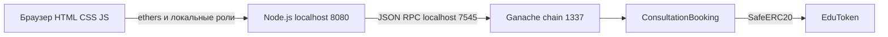
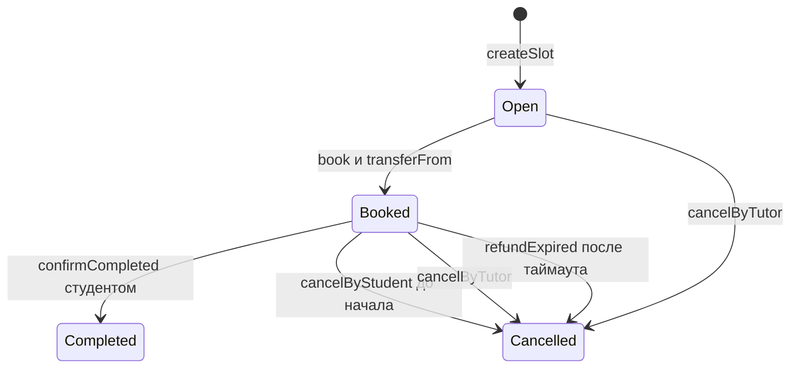

# Архитектура и жизненный цикл

Интерфейс получает ABI и текущие адреса от локального сервера. Подпись в демонстрации выполняется разблокированным аккаунтом Ganache. База данных сервера не хранит состояние брони: таблица консультаций читает `slots` и балансы из EVM. Текст последней операции в браузере исчезает при обновлении, но транзакции и журналы остаются в локальной цепочке. Имена ролей — отображение адресов в интерфейсе, а не on-chain идентификация личности.

В интерфейсе использованы светлый фон, компактный блок аккаунта, три показателя балансов и таблица консультаций. Статусы отмечены цветом; кнопки доступны по роли и состоянию записи. На мобильном экране таблица прокручивается внутри контейнера. Навигация связывает расписание и журнал операций.

`Open=0`, `Booked=1`, `Completed=2`, `Cancelled=3`. Закрытые состояния терминальные. Отменённый слот не открывается повторно: преподаватель создаёт новый ID. Время отмены студентом: `t < startsAt`; подтверждения: `startsAt <= t < startsAt + 86400`; возврата по таймауту: `t >= startsAt + 86400`. Для unknown slot применяется отдельная проверка `slotId < slotCount`, поэтому нулевое значение mapping не считается существующим открытым слотом.

Цена хранится в минимальных единицах EDU, `uint128`; начало — `uint64`, счётчик — `uint256`. `token`, `tutor`, `refundDelay` неизменяемы. Приватная `_refund` устанавливает Cancelled до перевода и отправляет оплату только сохранённому студенту. Право вызвать таймаут открыто всем, но изменить получателя нельзя.

План развития: внешний кошелёк вместо локальных signers, несколько преподавателей, согласованный арбитраж, индексатор событий, затем публичная тестовая сеть. Эти функции в текущий MVP не включены.
